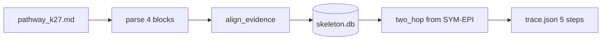

# 模块：W0 开发准备（冻结 + 规则 + 骨架）

| 项 | 内容 |
| --- | --- |
| 交接人 | T1 |
| 日期 | 2026-10-22 |
| 周次 | W0 |
| 分支 | docs/agent-w0-prep |
| 关联 Issue | #14 |

## 一句话说清它干什么

让六个人在明天开工前，有同一个冻结锚点、同一套合并规则、同一条能跑通的骨架命令，避免六份工作各长各的。

## 数据流

输入一份 markdown 临床路径文档 → 按空行切段并存为资产块 → 把硬编码的 12 条本体三元组逐条锚定到原文段落 → 写入 SQLite 单文件 → 从「上腹痛」出发做两跳无向遍历 → 按科室累积置信度投票得出结论 → 输出 trace.json（五步 step，每步带 evidence 锚点）。

## 我改了什么（人工修改点）

1. 解析器原写法遇到块首行以 `#` 开头就 `continue`，把标题后面的正文一起丢掉，导致 blocks=0、12 条三元组全断链；改为块内逐行过滤标题行、保留剩余正文。
2. 溯源完整率原公式 `ok/all_refs` 只统计已存在的证据串，断链时分母变小反而满分；改为「有真实锚点的三元组 / 三元组总数」。
3. 加 `-B` / `PYTHONDONTWRITEBYTECODE=1`：改同一个数字但文件字节数不变时，`__pycache__` 会让门禁假绿，实测 0.80→0.81 未触发变红。
4. 每个 step 的 evidence 写盘前做 `sorted(set(...))` 去重。

## 怎么验证的

| 验证方式 | 具体内容 |
| --- | --- |
| 单元验证 | `python -B -m agent.skeleton` 输出 5 steps / 科室=消化内科 / 疾病=3 / 检查=2 / 溯源完整率=0.75，退出码 0 |
| 门禁验证 | `python -B tools/diff_json.py tmp/trace.json fixtures/golden_trace.json` 输出「骨架通电：与黄金文件一致」，退出码 0 |
| 反向验证 | 故意把置信度 0.80 改 0.81，diff 报 `骨架断了 1 处：$.conclusion.department_score: 0.81 vs 0.8`，退出码 1 |
| 边界情况 | 样本缺少 K21/K29 相关证据句时，正确报出 3 条断链并把完整率压到 0.75，不虚报满分 |

## 已知风险与留待后续

- 本体仍为 12 条硬编码，抽取能力尚未实现（T2 的 2.2）
- 只支持 `.md` 一种输入（T5 的 5.1）
- 两跳推理与结论投票为规则式，未接检索层（T5 的 5.4）
- `skeleton.yml` 尚未加入 main 的必需状态检查，等本次合入后再挂，避免旧分支被永久阻塞
