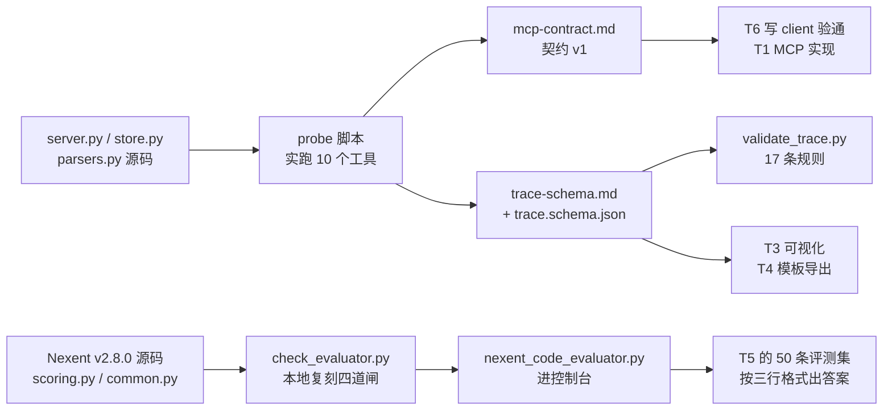

# 模块：MCP 工具契约与 Trace Schema

| 项 | 内容 |
| --- | --- |
| 交接人 | T1（xiangyuli494-cmyk） |
| 日期 | 2026-10-26 |
| 周次 | W1 |
| 分支 | `docs/t1-w0-base` |
| 关联 Issue | —（对应方案 §10.0 第 3 项，PR #22） |

## 一句话说清它干什么

让 T3/T4/T5/T6 不用猜 `agent/mcp-server` 的入参出参和 trace 字段名，照文档就能写客户端和可视化。

## 数据流

三份文档各自接一段链路，共同点是**都以代码为事实源，不以方案为事实源**：

关键一环是中间的 `probe 脚本 → 文档`：文档里每一段「真实响应」都是脚本跑出来的原文，不是手抄的。这样代码一改，重跑 probe 就能看出文档哪里过期。

## 我改了什么（人工修改点）

AI 起草，以下四个点是人工裁决的，必须留痕：

1. **溯源完整率的口径二选一**。代码里有两套：`store.write_trace()` 是「有 anchor 的证据条目占比」（`1 - len(unresolved)/len(cited)`），`agent/skeleton.py:266` 是「有锚点的三元组占比」（`len(anchors)/len(triples)`），同一份数据算出来一个 1.0 一个 0.75。裁决取前者，因为方案 §9 的 ≥95% 指标是挂在结论上的；skeleton 那套改名叫 `evidence_coverage`，避免两个都叫完整率。

2. **step 的字段名从三套里定一套**。方案 §8.1 用 `i/op/in/out/evidence`，`skeleton.py` 用 `step/op/detail/evidence/ref`，`trace_write` 实现是 `i/op/in/out/evidence`。裁决取实现那套（两票对一票，且 `skill_export` 已经在读 `s.get("i")` 和 `s.get("out")` —— 换名字会把已有导出功能弄坏）。

3. **`ref` 的优先级**。`store._ref_str()` 里带 `triple_id` 时直接返回 triple_id，**忽略同时传入的 anchor**。这个行为不合理（有 anchor 才能点回原文），但它是已发布行为，改它要动 `_ref_str` 和 32 份历史报告。裁决：文档里显式写明「优先 triple_id」并标注为已知缺陷，W2 再改，不在 W0 动。

4. **评估器结论的措辞**。最初想写「支持纯 Python」，实测后发现更准确的说法是「LLM 判定 + Code 判定两类，Code 判定是受限纯 Python」。差别在于后半句——如果只说「支持纯 Python」，T5 会以为能 `open()` 读评测集文件。

另外删掉了三类没证据的写法：方案里的示例 JSON（会和实现冲突）、「建议」「可以考虑」这类不落地的句子、以及所有没跑过的命令。

## 怎么验证的

| 验证方式 | 具体内容 |
| --- | --- |
| 单元测试 | `agent/tests/test_trace_schema.py` 18 个用例，`pytest agent/tests -q` → 18 passed |
| Schema 校验 | `python agent/tools/validate_trace.py` → ALL PASS，17 条规则逐条打印 |
| 评估器门禁 | `python agent/tools/check_evaluator.py` → `RESULT: ALL PASS`，含 1 项签名 + 7 个反例全被拒 + 6 个功能用例分数精确命中 |
| 契约自检 | `python tmp/verify_contract.py` → ALL PASS：10 个工具名与 `tests/test_mcp_client.py:21-32` 的 `EXPECTED` 一致、13 个错误码 doc/code 集合相等、30 个 `文件:行号` 锚点逐个命中关键字 |
| Lint | `ruff check agent/` → All checks passed |
| 端到端 | `python agent/tests/test_mcp_client.py` → `MCP CLIENT OK`（stdio 真起服务，10 个工具全调一遍） |
| 边界情况 | trace：缺 `i`/缺 `op`/`in` 传字符串/`evidence` 传字符串/`i` 从 0/`i` 不连续；评估器：`import os`/`subprocess.run`/`os.system`/dunder 逃逸/顶层 `open()`/顶层 `class`/参考答案非 JSON/空回答 |
| 未验证 | 控制台内实测（粘贴评估器 → 发布 → 跑一条 → 截图）。原因是本机 `dockerd` 起不来，归 T6 W1 |

最值得记的一条边界：`evidence` 传字符串不会报错，会**按字符遍历**——传 `"T-0f5bfa1d"` 得到 `evidence_count=9`、`unresolved=['T','-','0','f','5','b','a','1','d']`。静默产垃圾，所以 schema 里把 `evidence` 强制成数组。
