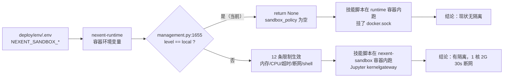

# 模块：Nexent 沙箱版本号与技能脚本限制（W0 第 1 项结案）

| 项 | 内容 |
| --- | --- |
| 交接人 | T1（xiangyuli494-cmyk）代做；原责任人 T6（Dewqian） |
| 日期 | 2026-10-28 |
| 周次 | W1（结的是 W0 遗留项） |
| 分支 | `docs/t6-w0-sandbox` |
| 关联 Issue | — 对应方案 §10.0 第 1 项 |

## 一句话说清它干什么

让全组知道技能脚本在当前部署里一条限制都没生效，并给出切到 docker 级的唯一那个变量。

## 数据流



一句话读图：**限制不是配在 .env 里就生效的**，中间有一道 `if level == "local": return None` 的闸。这道闸就是这个模块的全部要点。

## 我改了什么（人工修改点）

AI 起草，以下四条是人工裁决/人工发现的，必须留痕：

1. **发现「配置有 12 条、生效 0 条」**。最初只打算照 .env 抄一张清单交差，抄完顺手 `docker exec` 看了一眼实际环境变量，发现 `NEXENT_SANDBOX_DEFAULT_LEVEL=local`；再去 `management.py:1655` 读实现，才看到 local 级直接 `return None`。这一步决定了整份文档的结论方向——**不是「限制有哪些」，而是「限制在不在」**。

2. **把「版本号」拆成四个号**。T6 原话是「沙箱版本号是多少」，但 Nexent 里没有这个单一字段：平台 v2.7.0、沙箱镜像 v2.7.0、镜像内 Python 3.11.16、隔离级别 local。裁决：四个号并列写，并注明 W0-03 的依据是 v2.8.0，本机是 v2.7.0，避免答辩时说不清。

3. **截图改成 digest**。落定方式原文写的是「控制台『关于』页截图」，我这侧出不了浏览器截图。裁决：用镜像 tag + image digest 替代，并在 §7 如实写明替代关系——digest 比截图难伪造，也更好复核。没有假装有截图。

4. **「沙箱里有什么库」实测而非推断**。写了 `docker run --rm --network none  python -c "import ..."` 逐个 import，才发现缺 `fitz`（PyMuPDF）。这条直接推到方案 §5 第 3 条结论：PDF 解析不能放技能脚本。

## 怎么验证的

```bash
# 1. 版本号（应输出 v2.7.0 三个镜像）
docker inspect nexent-runtime nexent-web nexent-config --format '{{.Name}} {{.Config.Image}}'

# 2. 限制清单（应看到 DEFAULT_LEVEL=local 与另外 12 个 NEXENT_SANDBOX_*）
docker exec nexent-runtime env | grep NEXENT_SANDBOX

# 3. 策略被短路（应看到 if level == "local": return None）
docker exec nexent-runtime sh -lc "sed -n '1650,1680p' /opt/backend/management/services/agent/management.py"

# 4. 沙箱容器从没起过（应无输出）
docker ps -a --filter name=sandbox

# 5. 镜像里缺 fitz（应报 ModuleNotFoundError）
docker run --rm --network none ccr.ccs.tencentyun.com/nexent-hub/nexent-sandbox:v2.7.0 \
  python -c "import fitz"
```

第 4 条是这份结案里最关键的一次验证：**没有任何 `nexent-sandbox-*` 容器**，说明这个环境从未真正执行过技能脚本。所有「沙箱限制」目前都只是 .env 里的字符串。

结果记录在 `agent/docs/W0-01-沙箱版本号与脚本限制核实.md` §8 附录，含原始输出。
