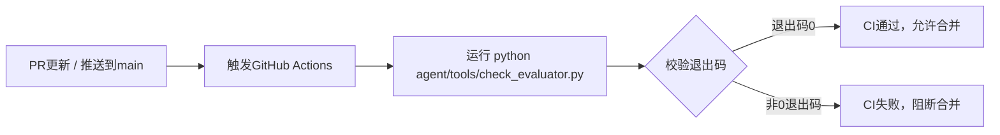

# 模块: evaluator_ci_gate

| 项 | 内容 |
| --- | --- |
| 交接人 | T6 |
| 日期 | 2026-11-02 |
| 周次 | W2 |
| 分支 | feat/agent-T6-evaluator-four-gate-ci |
| 关联 Issue | # |

## 一句话说清它干什么
给PR和main分支推送增加evaluator四道闸自动校验，拦截校验失败提交。

## 数据流
触发CI → 拉取代码 → 执行 check_evaluator.py → 校验成功放行 / 失败阻断合并

## 我改了什么（人工修改点）

1. 新增 `.github/workflows/eval-gate.yml` CI 流水线配置文件，配置 evaluator 四道闸自动校验
2. 设置触发规则：PR 更新、向 main 分支推送时自动执行
3. 配置环境与运行命令，复用已有 check_evaluator.py，不修改原有业务脚本

## 怎么验证的

| 验证方式 | 具体内容 |
| --- | --- |
| 单元测试 | 无新增单元测试，复用已有 check_evaluator.py |
| 手工验证 | 本地执行 `python agent/tools/check_evaluator.py`，返回码 0，校验逻辑正常 |
| 边界情况 | 脚本报错时 CI 返回失败、阻断合并；脚本正常时 CI 放行 |

## 已知风险与留待后续

1. 校验逻辑依赖 `agent/tools/check_evaluator.py`，该脚本变更会同步改变 CI 校验规则
2. 仅新增 CI 配置，不会影响业务代码运行