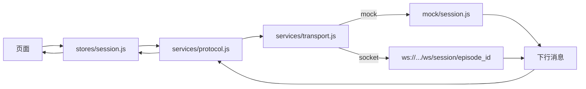

# 用户端小程序骨架 v0.1

> 状态：W2 骨架，T3 接手后继续填页面。
> 决策来源：[`docs/adr/ADR-020-用户端增加小程序预览形态.md`](../adr/ADR-020-用户端增加小程序预览形态.md)。
> 协议来源：[`docs/api/ws-protocol.md`](../api/ws-protocol.md) v0.1。
> 范围口径：`docs/plan/00-项目工期与范围基线.md` §3.3「微信小程序上架」仍属**明确不做**；本文只覆盖**开发者工具预览**。

---

## 1 一句话

同一套 uni-app（Vue 3）源码，编译出 H5（主演示）与微信小程序（预览），共用协议层与设计令牌，不新增后端与数据库。

## 2 与既有文档的关系

| 文档 | 关系 |
| --- | --- |
| ADR-004 | 用户端采用 uni-app、编译为 H5 与小程序；本文是其工程落地 |
| ADR-020 | 明确「预览可以、上架不做」的边界 |
| `docs/plan/00` §3.3 | 小程序上架仍排除，本文不改变该结论 |
| `docs/api/ws-protocol.md` | 唯一的 wire 格式来源；本文只做映射，不新增消息 |
| `docs/specs/device-ia.md` | 设备端是本体；用户端是远程延伸，交互更轻 |
| `docs/specs/access-control.md` | 用户端令牌与可见性规则；骨架阶段不实现登录 |

## 3 目录

```text
frontend/user-app/
├── src/
│   ├── api/            统一请求层（只读 VITE_API_BASE）
│   ├── components/     AppHeader / ElderButton / FlowBar / StepList / CaptionText
│   ├── constants/      11 节点与 9 步换算、通道与升级文案
│   ├── mock/           演示陪诊单与脚本会话（VITE_DEMO_MODE=1）
│   ├── pages/          home / session / journey / profile
│   ├── services/       protocol.js（纯函数） / transport.js（uni API）
│   ├── stores/         pinia 会话状态
│   ├── styles/         设计令牌（--scale 三档）
│   └── utils/          字幕加粗、时间格式、本地存储
├── tests/              node --test，零依赖
├── manifest.json       小程序 appid = touristappid
├── pages.json          四个页面，全部自定义导航栏
└── vite.config.js      端口 5173，envDir 指向仓库根目录
```

## 4 页面

| 页面 | 路径 | 作用 | 关键约束 |
| --- | --- | --- | --- |
| 首页 | `pages/home/index` | 输入陪诊单号、开始陪诊、进入进度与设置 | 单号来自服务台，不采集证件号 |
| 问小暖 | `pages/session/index` | 字幕、主操作、选项、文字输入、一键求助、数据流 | 不自行推进节点；主操作文案只取 `primary_label` |
| 陪诊进度 | `pages/journey/index` | 9 步进度、时间轴、待办、陪诊单摘要 | 9 步换算只在展示层；时间轴不含剂量字段 |
| 我的 | `pages/profile/index` | 字号三档、通道、家属可见开关 | 设置只在本机生效，不上行 |

## 5 数据流



规则：

1. 页面不直接拼消息，只调用 store 的 `sendControl` / `sendText`；
2. store 不解释业务，只保存服务端最近一次下发的状态；
3. `protocol.js` 不接触平台 API，Node 可直接单测；
4. `transport.js` 是唯一接触 `uni.connectSocket` 的文件，平台差异收敛在此。

## 6 协议映射

| 场景 | 上行 | 下行 | 用户端表现 |
| --- | --- | --- | --- |
| 进入会话 | `session.hello`（`client: "user"`） | `session.ready` | 顶部显示连接状态，按 `state` 渲染 |
| 点主操作 | `touch.event { target: "primary" }` | `turn_result` | 字幕、主操作文案、步序更新 |
| 点选项 | `touch.event { target: "option:<slot_id>" }` | `turn_result` | 同屏更新 |
| 一键求助 | `touch.event { target: "sos" }` | `turn_result`（`escalation: "sos"`） | 大字提示，不弹错误框 |
| 文字输入 | `text.input` | `turn_result` | 麦克风选型前代替语音 |
| 收到轮次 | `ack { turn }` | — | 服务端据此决定重连补发 |
| 保活 | `ping` | `pong` | 15 秒一次，静默 |

`turn_result` 的 `flow.total` 恒为 11；用户端按 `docs/specs/domain-model.md` §2.3 换算成 9 步展示，换算函数在 `constants/status.js`，有单测覆盖。

## 7 演示模式

| 项 | 值 | 说明 |
| --- | --- | --- |
| `VITE_DEMO_MODE` | `1`（默认） | 使用 `mock/session.js`，零网络 |
| 演示单号 | `ep_001` | 与 `tools/mock_api.py` 一致 |
| 演示会话 | 11 节点脚本 | `primary` 推进一轮；`sos` 与「找不到」触发升级 |
| 数据 | 自建样例 | 不含真实患者信息，不落库 |

要连真实服务：`VITE_DEMO_MODE=0`，并设置 `VITE_API_BASE` / `VITE_WS_BASE` / `VITE_EPISODE_ID`。

## 8 小程序约束

| 约束 | 影响 | 处理 |
| --- | --- | --- |
| 合法域名 | `http://127.0.0.1` 与 `ws://` 被拦 | 开发者工具勾选「不校验合法域名」；正式环境须 HTTPS/WSS |
| 无 `localStorage` | H5 写法不可用 | 统一走 `uni.setStorageSync`（`utils/storage.js`） |
| 无 DOM | 不能用 `document` / `window` | 组件只用 `view` / `text` / `button` |
| 音频 | 骨架不采集 | `mic` 用文字输入代替，等 T5 适配器 |
| 上架 | 需企业主体 | 本期不做，`appid` 保持测试号 |

## 9 测试

| 层 | 工具 | 覆盖 |
| --- | --- | --- |
| 协议纯函数 | `node --test` | 构造、解析、校验、非法输入 |
| 9 步换算 | `node --test` | 11 → 9、合并节点、越界、终态 |
| 字幕切段 | `node --test` | 拼接后逐字一致、长词优先 |
| 文案红线 | `node --test` + `tools/check_guard_words.py` | 禁用词 0 |
| 演示会话 | `node --test` | ready、ping/pong、11 节点、升级 |
| 构建 | 手工 | H5 与 mp-weixin 各构建一次 |
| 页面 | 手工 / 后续 Playwright | H5 主流程；小程序开发者工具人工走查 |

命令：

```powershell
cd frontend/user-app
npm test          # 39 条，零依赖
npm run build:h5
npm run build:mp-weixin
```

## 10 明确不做

- 不做小程序上架、审核、正式域名配置；
- 不做登录与短信验证码（`docs/specs/access-control.md` 的令牌方案留到 W3）；
- 不搭数据库，不新增后端接口；
- 不做语音采集与 TTS 播放；
- 不做家属端页面（`frontend/family/` 仍为空，由 T3 在 W3 起实现）。
